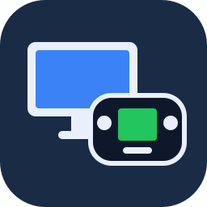

# DeckScreen



Transforma o **Steam Deck** em **segunda tela + controle** do seu PC Linux, no estilo do GamePad do Wii U.

- **Tela extra de verdade:** a tela do Deck vira mais um monitor do PC. Você arrasta janelas para ela e toca para clicar.
- **Controle:** botões, analógicos e trackpads do Deck chegam ao PC como um controle (com giroscópio opcional).
- **Modo Wii U (Cemu):** a janela do GamePad vai sozinha para o Deck, em tela cheia, e o jogo fica no monitor/TV.
- **Só no Deck:** desliga os monitores do PC enquanto você joga pelo Deck e religa tudo ao desconectar.
- **Espelhar** e **tela vertical** (experimental).
- **Liga o PC pelo Deck** (Wake-on-LAN), **teste de conexão** com dicas e **diagnóstico** do PC, tudo no Modo Jogo.
- Tudo pelo menu **Decky**, com vários PCs salvos.

> O vídeo, o som e o controle viajam pelo **Sunshine** (PC) e pelo **Moonlight** (Deck), projetos abertos e consagrados. O DeckScreen junta tudo: cria a tela virtual, configura o Sunshine, faz o pareamento com um clique e abre o Moonlight com as opções certas.

```
 Steam Deck (Modo Jogo)                          PC Linux
┌───────────────────────────┐   rede local   ┌──────────────────────────────────────┐
│ Plugin Decky "DeckScreen" │ ─ HTTP 47555 ──▶│ deckscreen-host (Rust, serviço)      │
│   PCs, pareamento, opções │   (assinado)   │   pareamento, tela virtual, perfis,  │
│   teste de rede, WoL      │ ◀─ UDP 47556 ── │   diagnóstico, widget do KDE         │
│ Moonlight (Flatpak)       │ ◀── vídeo ───── │ Sunshine                             │
│   tela, toque, controle   │ ── controle ──▶ │                                      │
└───────────────────────────┘                └──────────────────────────────────────┘
```

## O que funciona em cada área de trabalho

| PC | Deck como monitor extra | Espelhar + controle |
|---|---|---|
| **KDE Plasma 6 (Wayland)**, ex.: CachyOS, Fedora KDE, Kubuntu | ✅ completo, com widget na bandeja | ✅ |
| **Hyprland** | 🧪 experimental | ✅ |
| **GNOME (Wayland)**, ex.: Ubuntu, Fedora Workstation | ⏳ em breve ([veja abaixo](#gnome)) | ✅ |
| X11 e outras | ❌ | ✅ |

## O atraso é alto?

Em rede local costuma ficar perto de **um quadro (≈16 ms a 60 FPS)**: o Deck decodifica o vídeo em menos de 1 ms, e o resto vem da compressão no PC e da rede. O que mais pesa é o **Wi-Fi**: use 5/6 GHz no Deck e, de preferência, o PC no cabo. No menu do Deck, **Testar conexão** mede a sua rede e diz o que melhorar, e **Mostrar medidor de atraso** exibe os números durante o uso.

---

## Instalação no PC

### Qualquer distro: AppImage

1. Baixe `DeckScreen-<versão>-x86_64.AppImage` em [Releases](../../releases).
2. Dê permissão de execução (botão direito → Propriedades → "Executável") e abra com dois cliques. Se preferir, no terminal:
   ```bash
   chmod +x DeckScreen-*.AppImage
   ./DeckScreen-*.AppImage install
   ```

O instalador se copia para `~/.local/bin`, então o AppImage pode ser apagado depois. Ele também:
- instala o que faltar pelo gerenciador da sua distro (pacman, apt, dnf ou zypper);
- instala o **Sunshine** se ele não estiver no PC (pacote no Arch, AppImage oficial nas outras distros);
- configura o Sunshine, com backup dos arquivos originais;
- cria o serviço de usuário, o widget do KDE e o atalho "DeckScreen: desconectar";
- libera as portas no firewall e ativa o Wake-on-LAN, sempre perguntando antes;
- termina com um diagnóstico completo.

### CachyOS / Arch

Use o AppImage acima ou **uma** das opções abaixo. Rode só uma delas; não cole os três blocos juntos.

**A) Pelo código-fonte** (compila com o `cargo`, leva menos de um minuto):
```bash
git clone https://github.com/lucasfracaro/deckscreen && cd deckscreen && ./install.sh
```

**B) Pacote de release com o binário pronto.** Primeiro baixe `deckscreen-host-<versão>-x86_64.tar.gz` em [Releases](../../releases). Depois, na pasta do download:
```bash
tar xzf deckscreen-host-*-x86_64.tar.gz && cd deckscreen-host-*/ && ./install.sh
```

**C) Como pacote do pacman.** Funciona a partir da versão publicada em Releases, porque o PKGBUILD baixa a tag `v<versão>`:
```bash
git clone https://github.com/lucasfracaro/deckscreen && cd deckscreen/packaging/arch && makepkg -si
deckscreen-host install
```

> **Atualizou o kernel e ainda não reiniciou?** Reinicie antes de usar. O controle virtual do Sunshine precisa dos módulos `uinput`/`uhid` do kernel em execução, e o `deckscreen-host doctor` avisa quando eles faltam.

## Instalação no Steam Deck

O plugin é o arquivo `DeckScreen-decky.zip`, publicado em [Releases](../../releases). Não precisa copiar nada para o Deck: o Decky instala direto do link.

1. No Modo Jogo, abra **⋯ → Decky → ⚙ (Configurações) → Geral** e ative o **Modo desenvolvedor**.
2. Na aba **Desenvolvedor**, em **Instalar plugin a partir da URL**, digite o endereço abaixo e toque em **Instalar**:
   ```
   https://github.com/lucasfracaro/deckscreen/releases/latest/download/DeckScreen-decky.zip
   ```
3. Confirme o aviso de plugin de terceiros. O **DeckScreen** aparece na lista do Decky.

**Alternativa por arquivo:** no Modo Desktop, baixe o zip pelo navegador. Depois, no Modo Jogo, use **Desenvolvedor → Instalar plugin a partir de um arquivo ZIP → Navegar** e escolha o arquivo em `Downloads`.

## Primeiro uso

1. **⋯ → Decky → DeckScreen.** Se o Moonlight faltar, toque em **Instalar Moonlight**.
2. **Procurar PC na rede** → escolha o seu PC. Se ele não aparecer, digite o IP: o instalador mostra o IP no final.
3. **Parear com este PC.** O Deck mostra um PIN.
4. No PC, aceite a notificação **"Steam Deck quer se conectar — PIN 1234"**. Também dá para aceitar pelo widget da bandeja ou com `deckscreen-host accept`.
5. A janela cinza do Moonlight que abriu durante o pareamento mostra "pareado" e **fecha sozinha**. Isso era só o pareamento.
6. Abra de novo **⋯ → Decky → DeckScreen** e toque em **Conectar**. Agora sim a tela do PC aparece no Deck.

Também aparece um "jogo" chamado **DeckScreen** na sua biblioteca da Steam. Depois do pareamento, abrir esse jogo conecta direto ao PC.

## Opções

| No Deck | |
|---|---|
| **Modo** | Estender, Só no Deck ou Espelhar |
| **Posição / Escala / Orientação** | lado do monitor principal, tamanho do texto, horizontal ou vertical |
| **Perfil** | *Área de trabalho*, *Wii U (Cemu)* (abre o Cemu e manda a janela do GamePad para o Deck) ou *Personalizado* (você escolhe as janelas e o comando) |
| **Latência** | *Baixa latência* (sem V-Sync), *Equilibrado* ou *Qualidade* |
| **Medidor de atraso** | sobreposição do Moonlight com os tempos de rede e decodificação |
| **Toque = clique direto / Som no PC** | como a tela de toque e o áudio se comportam |
| **Giroscópio** | *Para emuladores* (padrão): o Deck vira uma fonte de movimento DSU/cemuhook na porta UDP 26760, e o Steam Input continua ligado (trackpad como mouse, layouts). *Direto pelo Moonlight*: desliga o Steam Input no atalho; os trackpads deixam de ser mouse |
| **Codec / Resolução / FPS / Bitrate** | HEVC por padrão; 90 FPS no Deck OLED |
| **Ligar o PC** | Wake-on-LAN: funciona com o PC suspenso e no cabo (ative também na BIOS) |
| **Testar conexão / Diagnóstico do PC** | mede a rede, aponta problemas e confere a instalação do PC |

### GNOME

Hoje, no GNOME, o Deck **espelha a tela e funciona como controle**. Para ele virar um monitor extra, o Sunshine precisa pedir ao próprio GNOME um monitor virtual. Isso exige uma opção nova, `portal_virtual_display`, que foi **proposta ao projeto oficial do Sunshine**.

O suporte já está pronto no DeckScreen e **ativa sozinho** quando o Sunshine instalado tiver essa opção. Ao conectar:
- o GNOME cria um monitor do tamanho do Deck, e o DeckScreen o posiciona;
- só na primeira conexão aparece "Compartilhar tela": escolha **Monitor virtual** e marque **Lembrar**;
- no modo Wii U, leve a janela para o Deck com **Super+Shift+→**, porque o GNOME não deixa programas moverem janelas.

Para testar antes com um Sunshine compilado com a opção (por exemplo, a branch `feat/portal-virtual-display` de [lucasfracaro/Sunshine](https://github.com/lucasfracaro/Sunshine)), use `deckscreen-host gnome-virtual on`.

### Experiência Wii U com o Cemu

No Cemu, ative **Options → Separate GamePad view**.

**Giroscópio no Cemu:** deixe o Giroscópio do DeckScreen em *Para emuladores*. Em **Options → Input settings**, no *Wii U GamePad*, mantenha o controle *SDLController* (os botões que chegam pelo Sunshine) e adicione um segundo, *DSUController*, com o IP do Deck (aparece no plugin) e a porta `26760`. O Dolphin, o Ryujinx e o Citra/Lime3DS aceitam a mesma fonte "DSU/cemuhook". Se o plugin avisar que a Steam não está mandando o giroscópio, use o giroscópio em alguma ação no layout de controle do atalho DeckScreen (por exemplo, "como mouse" ativado por um botão que você não usa): a Steam desliga o sensor quando nenhuma ação usa o giroscópio. No Deck, escolha o perfil **Wii U (Cemu)** com o modo **Estender** e toque em **Conectar**. O jogo fica no monitor ou na TV, e a tela do GamePad aparece em tela cheia no Deck, com toque. Para emuladores de duas telas (DS/3DS), use o perfil **Personalizado** com parte do título da segunda janela.

## Comandos no PC

```bash
deckscreen-host doctor      # diagnóstico completo
deckscreen-host status      # estado atual
deckscreen-host stop        # remove a tela do Deck e restaura os monitores (botão de pânico)
deckscreen-host accept      # aceita o pedido de pareamento pendente
deckscreen-host devices     # Decks pareados (forget ID para remover)
deckscreen-host report      # gera um .tar.gz com logs, sem senhas, para pedir ajuda
deckscreen-host sunshine-login       # mostra o usuário e a senha da interface web do Sunshine
deckscreen-host sunshine-login set   # troca o login (no Sunshine e no DeckScreen ao mesmo tempo)
deckscreen-host fix-input            # corrige o controle/mouse virtual (botões e trackpad do Deck)
deckscreen-host uninstall   # remove do PC
```

## Problemas comuns

| Sintoma | O que fazer |
|---|---|
| O Deck não acha o PC | Digite o IP. Confira o firewall e se não há "isolamento de clientes" no roteador |
| "A tela virtual não apareceu" | Use a sessão **Plasma (Wayland)** e instale o `krfb` |
| Tela preta | `deckscreen-host doctor`. O Sunshine **não pode ser a versão Flatpak** |
| O Sunshine pede usuário e senha no navegador | Foi o instalador que criou esse login: veja com `deckscreen-host sunshine-login` ou troque com `deckscreen-host sunshine-login set` |
| "Não acessa o Sunshine" | A senha da interface web mudou por fora: rode `deckscreen-host sunshine-login set` |
| A tela aparece, mas botões e trackpad do Deck não fazem nada | Reinicie o PC se o kernel foi atualizado; depois rode `deckscreen-host fix-input` (carrega `uinput`/`uhid`, instala a regra udev do Sunshine e coloca você no grupo `input`) e saia/entre na sessão |
| Cursor mexe, mas o clique não funciona | `systemctl --user restart app-dev.lizardbyte.app.Sunshine.service` |
| Monitores do PC desligados ou fora do lugar | `deckscreen-host stop`. O serviço também restaura sozinho se algo cair |
| "Relógio do Deck e do PC muito diferentes" | Ative a hora automática nos dois |

**Portas:** TCP 47984, 47989, 48010 (Sunshine) e 47555 (DeckScreen); UDP 47998–48000 (Sunshine) e 47556 (busca automática).

## Segurança

- Um Deck só recebe acesso depois que **você aprova no PC**. Nesse momento ele recebe uma chave secreta de 256 bits.
- Toda requisição do Deck é **assinada (HMAC-SHA256)** com horário e um código único. Uma requisição copiada ou alterada na rede é recusada.
- O conteúdo das configurações trafega **sem criptografia** na rede local. A chave nunca é reenviada depois do pareamento.
- O vídeo e o controle usam a criptografia do próprio Sunshine/Moonlight.
- O controle local (widget, comandos) só aceita conexões de `127.0.0.1` e recusa páginas web.
- A senha do Sunshine fica só no PC, em `~/.config/deckscreen/config.json` (permissão 600).

---

## Desenvolvimento

O funcionamento interno (arquitetura, protocolo, cada módulo, testes e release) está explicado em detalhes no **[README_DEV.md](README_DEV.md)**.

```
host/        serviço do PC em Rust, sem dependências externas (JSON, HTTP, SHA-256/HMAC próprios e testados)
  assets/    widget do Plasma, unidade do systemd, ícone
deck/        plugin do Decky: main.py (backend) + src/index.tsx (interface, compilada com tsc)
packaging/   AppImage e PKGBUILD
tests/       testes do plugin, teste de fumaça da interface e teste ponta a ponta Deck ↔ PC
build.sh     roda todos os testes e gera release/ (AppImage, tar.gz, zip do Decky)
```

```bash
cd host && cargo test            # 30 testes do serviço
./build.sh                       # tudo + pacotes
```

Releases são publicadas pelo GitHub Actions ao criar uma tag `v*`, com binário estático (musl) que roda em qualquer distro.

Créditos: a técnica de tela virtual com `krfb-virtualmonitor` + captura `kwin` foi inspirada no [Sunveil](https://github.com/ImStillBlue/sunshine-virtual-display), a abertura do Moonlight por atalho da Steam no [MoonDeck](https://github.com/FrogTheFrog/moondeck), e o servidor de giroscópio segue a conversão de eixos do [SteamDeckGyroDSU](https://github.com/kmicki/SteamDeckGyroDSU) (MIT).

Licença: MIT.
