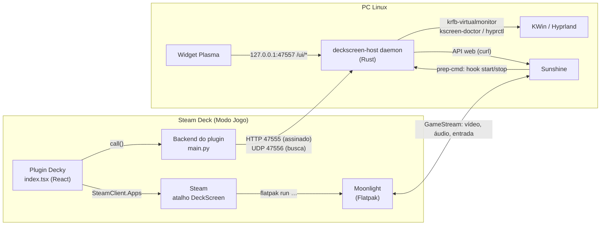
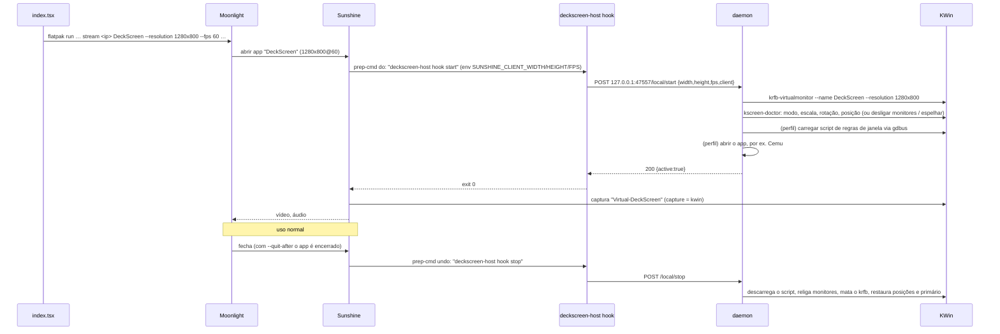

# DeckScreen — guia do desenvolvedor

Este documento explica **como o DeckScreen funciona por dentro**: arquitetura, protocolos, cada módulo do código, formatos de arquivo, testes, build e release. Para instalar e usar, veja o [README](README.md).

## Sumário

1. [Visão geral](#1-visão-geral)
2. [Mapa do repositório](#2-mapa-do-repositório)
3. [Fluxos principais](#3-fluxos-principais)
4. [Protocolo de rede](#4-protocolo-de-rede)
5. [Serviço do PC (Rust)](#5-serviço-do-pc-rust)
6. [Plugin do Steam Deck (Decky)](#6-plugin-do-steam-deck-decky)
7. [Widget do KDE Plasma](#7-widget-do-kde-plasma)
8. [Arquivos de configuração e estado](#8-arquivos-de-configuração-e-estado)
9. [Testes](#9-testes)
10. [Build, empacotamento e release](#10-build-empacotamento-e-release)
11. [Como estender](#11-como-estender)
12. [Depuração](#12-depuração)
13. [Decisões de projeto e limitações conhecidas](#13-decisões-de-projeto-e-limitações-conhecidas)

---

## 1. Visão geral

O DeckScreen **não transmite vídeo**. Quem faz isso são dois projetos abertos e maduros:

- **Sunshine**, no PC: captura a tela, codifica o vídeo, envia o áudio e cria um controle, mouse e teclado virtuais.
- **Moonlight**, no Deck: recebe e decodifica o vídeo e envia os toques, botões e analógicos.

O DeckScreen é a **cola** entre eles e o sistema:

| Problema | Quem resolve |
|---|---|
| Fazer o Deck virar um **monitor extra** do PC, e não só espelhar | `deckscreen-host`: cria uma saída de vídeo virtual no compositor (KWin/Hyprland) |
| Saber **quando** criar e remover essa tela | O Sunshine chama `deckscreen-host hook start/stop` ao abrir e fechar o app "DeckScreen" |
| **Parear** Deck e PC sem digitar nada | O plugin pede, o PC aprova por notificação, e o serviço digita o PIN do Moonlight no Sunshine pela API dele |
| Controlar tudo **do Modo Jogo** | Plugin do Decky (interface em React + backend em Python) |
| Mandar janelas para o Deck (modo Wii U) | Script do KWin carregado via D-Bus, ou regras de janela no Hyprland |
| Abrir o Moonlight com as opções certas | Atalho "DeckScreen" na Steam, com as opções de lançamento definidas pelo plugin |



---

## 2. Mapa do repositório

```
deckscreen/
├── host/                         serviço do PC, em Rust (sem dependências externas)
│   ├── Cargo.toml / Cargo.lock
│   ├── rustfmt.toml              max_width = 120
│   ├── src/
│   │   ├── main.rs               CLI: interpreta os comandos e chama os módulos
│   │   ├── daemon.rs             serviço: rotas HTTP, sessão da tela, watchdog, busca UDP
│   │   ├── display.rs            detecção da área de trabalho + backends KDE/GNOME/Hyprland/espelho
│   │   ├── pairing.rs            pedidos de pareamento, notificação, aprovação
│   │   ├── sunshine.rs           API do Sunshine (via curl), sunshine.conf e apps.json
│   │   ├── config.rs             config.json, configurações (Settings) e perfis
│   │   ├── install.rs            install/uninstall para qualquer distro
│   │   ├── doctor.rs             diagnóstico e relatório
│   │   ├── input.rs              controle virtual: /dev/uinput, /dev/uhid, regra udev, grupo input
│   │   ├── net.rs                interface, MAC, cabo/Wi-Fi, estado do Wake-on-LAN
│   │   ├── http.rs               servidor e cliente HTTP/1.1 mínimos
│   │   ├── json.rs               tipo JSON, parser e serializador
│   │   ├── crypto.rs             SHA-256, HMAC-SHA256, hex, aleatoriedade
│   │   └── util.rs               caminhos XDG, log, processos, data/hora, perguntas no terminal
│   └── assets/                   embutidos no binário com include_str!
│       ├── deckscreen-host.service      unidade systemd (@BIN@ é substituído)
│       ├── sunshine-wait-kwin.conf      drop-in: Sunshine espera o KWin subir
│       ├── deckscreen-stop.desktop      atalho "desconectar" no menu
│       ├── gnome-display.py             ajudante do GNOME (Mutter DisplayConfig via PyGObject)
│       ├── deckscreen.svg / .png        ícone
│       └── plasmoid/                    widget da bandeja do Plasma 6 (QML)
├── deck/                         plugin do Decky Loader
│   ├── plugin.json / package.json      metadados (package.json "type": "module" ⇒ carregamento ESM)
│   ├── main.py                   backend (roda no Deck, como usuário deck)
│   ├── src/index.tsx             interface (compilada só com tsc, sem bundler)
│   ├── src/globals.d.ts          tipos mínimos dos objetos globais do Decky
│   └── tsconfig.json
├── packaging/
│   ├── appimage/build-appimage.sh
│   └── arch/PKGBUILD + deckscreen-host.install
├── tests/
│   ├── fakedecky/decky.py        substituto do módulo `decky` para os testes
│   ├── test_deck_backend.py      testes unitários do main.py
│   ├── frontend_smoke.mjs        teste de fumaça da interface (React/Decky/Steam falsos)
│   └── integration.py            ponta a ponta: binário Rust real + main.py real
├── .github/workflows/ci.yml      testes a cada push
├── .github/workflows/release.yml build estático (musl) + publicação da release
├── build.sh                      roda tudo e gera release/
└── install.sh                    instalação a partir do código ou do pacote .tar.gz
```

---

## 3. Fluxos principais

### 3.1 Descoberta do PC

1. O backend do plugin envia o datagrama `DECKSCREEN_DISCOVER_V1` em broadcast para `255.255.255.255:47556`, duas vezes, esperando 1 s em cada.
2. Cada `deckscreen-host` responde por unicast com `{"app":"deckscreen","name":<hostname>,"port":47555,"version",…,"auth":"hmac-v1","capability":"virtual|mirror"}`.
3. O plugin lista os PCs. Se o usuário digitar um IP, o plugin chama `GET /api/hello` para confirmar que é um DeckScreen compatível (`auth == "hmac-v1"`).

O PC é salvo pelo **hostname** (`id`). Se o IP mudar, adicionar de novo atualiza o mesmo registro.

### 3.2 Pareamento

```mermaid
sequenceDiagram
  participant U as Usuário
  participant UI as index.tsx
  participant PY as main.py
  participant ML as Moonlight
  participant D as deckscreen-host
  participant N as notify-send
  participant S as Sunshine

  UI->>PY: pair_start()
  PY->>PY: gera PIN de 4 dígitos
  PY->>D: POST /api/pair/request {device_id, device_name, pin}
  D->>N: notificação "Deck quer se conectar — PIN 1234" [Aceitar|Recusar]
  D-->>PY: {request_id}
  UI->>ML: atalho Steam: flatpak run … pair <ip> --pin 1234
  ML->>S: pedido de pareamento GameStream (PIN 1234)
  U->>N: clica Aceitar
  N-->>D: stdout "accept"
  D->>D: cria chave de 256 bits, salva o device em config.json
  D->>S: GET /api/pin → pairing_id; POST /api/pin {pairing_id, pin, name}
  S-->>ML: pareamento GameStream concluído
  loop a cada 1,5 s (até 3 min)
    UI->>PY: pair_status(request_id)
    PY->>D: GET /api/pair/status?id=…
    D-->>PY: {state:"approved", key, sunshine:"ok"}
  end
  PY->>PY: guarda a chave em settings.json
  UI->>ML: TerminateApp (fecha a janela de pareamento)
```

Detalhes importantes:
- **Duas confianças diferentes.** A *chave do DeckScreen* autoriza o Deck a mexer nas configurações e na tela. O *pareamento do Moonlight/Sunshine* (certificados GameStream) autoriza o streaming. O mesmo PIN serve aos dois, e o usuário aprova uma vez só.
- A chave só é entregue ao **mesmo IP** que fez o pedido. Pedidos expiram em 5 min, e no máximo 3 ficam pendentes ao mesmo tempo (o resto recebe 429).
- `submit_pin` funciona com as duas gerações da API do Sunshine:
  - **nova:** `GET /api/pin` lista os pedidos com `id` e `address`; escolhe-se o que tem o IP do Deck e envia-se `POST {pairing_id, pin, name}`;
  - **antiga:** `POST {pin, name}` direto.

  Ele tenta de novo a cada 1,5 s por até 90 s, porque o Moonlight pode demorar a iniciar o pedido.
- Sem `notify-send`, a aprovação é feita pelo widget do Plasma (`/ui/decide`) ou por `deckscreen-host accept`.

### 3.3 Conexão (a tela do Deck nasce e morre)



- O `hook` **sempre sai com código 0**: uma falha do DeckScreen nunca derruba a transmissão. No pior caso, o Sunshine cai no primeiro monitor (o `kwingrab` do Sunshine usa o primeiro output quando o `output_name` não existe).
- O app "DeckScreen" no Sunshine não tem comando (`"cmd": ""`), igual ao app "Desktop": ele "roda" até o cliente encerrar.
- **Encerrar** no Deck chama `POST /api/stop`, que pede ao Sunshine para fechar o app (`/api/apps/close`) e desmonta a tela. Depois disso, o plugin manda a Steam terminar o atalho.

### 3.4 Wake-on-LAN

O MAC do PC chega ao Deck pelo campo `network.mac` de `/api/status`. Ele é calculado a partir da interface que alcança o IP do Deck (`ip route get <deck>` → `dev X` → `/sys/class/net/X/address`) e fica guardado no `settings.json` do plugin. Para acordar o PC, o plugin:

1. envia o pacote mágico (6×`FF` + 16×MAC) para `255.255.255.255` e `a.b.c.255`, portas 9 e 7, três vezes;
2. consulta `GET /api/hello` a cada 2 s, repetindo o pacote, por até 90 s;
3. espera mais 3 s para o Sunshine terminar de voltar e só então conecta.

---

## 4. Protocolo de rede

### 4.1 Portas

| Porta | Quem escuta | Para quê |
|---|---|---|
| TCP **47555** (`0.0.0.0`) | daemon | API para o Deck (`/api/*`) |
| UDP **47556** (`0.0.0.0`) | daemon | busca automática |
| TCP **47557** (`127.0.0.1`) | daemon | controle local: hooks e CLI (`/local/*`), widget (`/ui/*`) |
| UDP **26760** (`0.0.0.0`, **no Deck**) | plugin (`dsu.py`) | giroscópio para emuladores (DSU/cemuhook), só com *Giroscópio → Para emuladores* |
| TCP 47984, 47989, 48010 · UDP 47998–48000 | Sunshine | GameStream |
| TCP 47990 (`localhost`) | Sunshine | interface/API web (HTTPS) |

### 4.2 Assinatura das requisições (`hmac-v1`)

Toda rota `/api/*`, exceto `hello`, `pair/request` e `pair/status`, exige estes cabeçalhos:

```
X-DS-Device: <device_id>              # identificador do Deck (hex, até 64 caracteres)
X-DS-Time:   <unix_seconds>
X-DS-Nonce:  <16–64 caracteres hex, aleatório>
X-DS-Sig:    hex( HMAC-SHA256( key, mensagem ) )

mensagem = METHOD "\n" TARGET "\n" TIME "\n" NONCE "\n" hex(SHA256(corpo))
```

- `TARGET` é o caminho **com** a query string, exatamente como enviado (por exemplo, `/api/pair/status?id=abc`).
- O servidor recusa com 401 quando: o dispositivo é desconhecido; a diferença de relógio passa de **300 s**; o nonce é inválido ou **repetido** (o cache guarda nonces por 600 s); ou a assinatura não confere. A comparação é em tempo constante.
- Implementação no Deck: `sign_headers()` em `deck/main.py`. No PC: `State::verify()` em `daemon.rs`.
- **O que isso garante:** autenticidade e integridade, e impede replay. **O que não garante:** sigilo, porque o corpo trafega em claro. A chave só circula uma vez, na resposta de `pair/status`.

### 4.3 Rotas

**Públicas (porta 47555)**

| Método e rota | Corpo / resposta |
|---|---|
| `GET /api/hello` | → `{app, version, name, auth:"hmac-v1", paired, desktop, capability}`. `paired` só é `true` se a própria requisição veio assinada |
| `POST /api/pair/request` | `{device_id, device_name, pin}` → `{request_id}` · 400 (PIN inválido) · 429 (muitos pendentes) |
| `GET /api/pair/status?id=` | → `{id, state: pending\|approved\|denied, sunshine: waiting\|ok\|failed, device_id, key\|null}` |

**Assinadas (porta 47555)**

| Método e rota | Resposta |
|---|---|
| `GET /api/ping` | `{pong: <unix>}` |
| `GET /api/status` | `{display, settings, diagnostics, name, version, desktop, capability, network}` |
| `GET /api/settings` | configurações (ver §8.1) |
| `PUT\|POST /api/settings` | recebe um patch parcial e devolve as configurações validadas |
| `POST /api/stop` | fecha o app no Sunshine e desmonta a tela → `display` |
| `POST /api/unpair` | esquece este Deck |
| `GET /api/doctor` | `{checks: [{label, status: ok\|warn\|fail, detail}]}` |

**Locais (127.0.0.1:47557).** Qualquer requisição com cabeçalho `Origin` é recusada, o que bloqueia páginas web.

| Método e rota | Proteção | Uso |
|---|---|---|
| `POST /local/start`, `POST /local/stop` | `X-DeckScreen-Local: <local_secret>` | hooks do Sunshine, `deckscreen-host stop` |
| `GET /local/pending`, `POST /local/decide`, `GET /local/status` | idem | CLI |
| `GET /ui/status`, `POST /ui/stop`, `POST /ui/decide` | `X-DeckScreen-UI: 1` | widget do Plasma. O cabeçalho customizado força um *preflight* CORS que o servidor nunca responde, o que impede uso por páginas web |

O `local_secret` fica no `config.json`, que tem permissão 600, então só o próprio usuário consegue ler.

---

## 5. Serviço do PC (Rust)

**Por que sem dependências externas?** Para compilar em qualquer lugar só com o `rustc`, inclusive em ambientes sem acesso ao crates.io, sem atrito de licenças e com um binário pequeno (≈900 KB, estático em musl). O preço: JSON, HTTP e criptografia são implementações próprias, pequenas e cobertas por testes, incluindo os vetores oficiais de SHA-256 e HMAC.

### 5.1 `main.rs` — CLI

- Chama `util::ensure_session_env()` (que precisa rodar enquanto o processo ainda tem uma thread só, porque usa `set_var`) e despacha o subcomando.
- Comandos: `daemon`, `hook start|stop`, `install`, `uninstall`, `doctor`, `report`, `setup`, `status`, `stop [--quiet]`, `pending`, `accept|deny [ID]`, `devices`, `forget ID`, `version`, `help`.
- Sem argumentos e **sem terminal**, como no clique duplo no AppImage, ele abre um terminal (konsole, gnome-terminal, kgx, xfce4-terminal, alacritty ou xterm) rodando `install`.

### 5.2 `daemon.rs` — o serviço

- **`Screen`**: guarda a sessão atual (`backend`, `output`, `session`, `last_error` e o processo `app` do perfil).
  - `start(req, cfg)` lê as configurações, resolve o perfil, chama `backend.start()` e, se o perfil pedir, abre o app em um *process group* próprio, com saída em `app.log`.
  - `stop(close_app)` mata o grupo do app (com `kill -TERM -<pgid>`) quando configurado e chama `backend.stop()`.
  - `watchdog()` roda a cada 3 s: se o backend diz que a tela morreu sozinha, restaura os monitores.
- **`State`**: estado compartilhado (`Arc`). Contém `cfg: Mutex<Config>`, `screen: Mutex<Screen>`, `pairing`, `api` (do Sunshine), `desktop`, o cache de nonces e um cache genérico (diagnóstico: 15 s; rede por IP do Deck: 60 s).
- **`lan_handler` / `local_handler`**: roteiam as requisições conforme as tabelas do §4.3.
- **`discovery_loop`**: responde ao broadcast UDP.
- **`run()`**:
  1. detecta a área de trabalho e carrega o `config.json`;
  2. cria o backend e chama `backend.recover()`, que desfaz resíduos de uma sessão que caiu;
  3. sobe os dois servidores HTTP e a busca UDP;
  4. entra no laço do watchdog.

**Concorrência:** o servidor usa uma thread por conexão. Toda mudança de tela passa pelo `Mutex<Screen>`, então nunca há dois `start`/`stop` ao mesmo tempo. Quando os dois locks são necessários, a ordem é sempre `cfg` → `screen`, para evitar *deadlock*.

### 5.3 `display.rs` — a tela do Deck

```rust
pub trait Backend: Send {
    fn name(&self) -> &'static str;
    fn start(&mut self, req: &StartReq, s: &Settings, p: &Profile) -> Result<String, String>; // nome do output ("" = só espelho)
    fn stop(&mut self);
    fn alive(&mut self) -> bool;
    fn recover(&mut self) {}
}
```

`capability()` no GNOME só devolve `virtual` quando o Sunshine tem a opção `portal_virtual_display`. `sunshine::refresh_gnome_virtual()` decide isso de dois jeitos:
- procura o texto `portal_virtual_display` dentro do executável nativo do Sunshine (`supports_portal_virtual()`; não funciona com AppImage, que é comprimido);
- ou lê a ativação manual `sunshine.portal_virtual` do `config.json`, gravada por `deckscreen-host gnome-virtual on`.

O daemon, o instalador, o `doctor` e o `setup` chamam essa função. Assim, quando a opção chegar ao Sunshine oficial, o suporte liga sozinho.

`detect_desktop()` decide nesta ordem:
1. `HYPRLAND_INSTANCE_SIGNATURE` + `hyprctl` → Hyprland;
2. `XDG_CURRENT_DESKTOP` contém kde, hyprland ou gnome;
3. processo em execução (`pgrep -x kwin_wayland`, `Hyprland`, `gnome-shell`);
4. caso contrário, "outra".

`capability()` devolve `virtual` para KDE em Wayland e para Hyprland; em qualquer outro caso, `mirror`. `backend_for()` escolhe a implementação.

#### KDE (`KdeBackend`)

O acesso ao sistema passa pelo trait `KScreen` (com `RealKScreen` em produção e `FakeKs` nos testes):

| Método | Implementação real |
|---|---|
| `outputs()` | `kscreen-doctor -j` → `outputs[]` (ignora avisos antes do `{`) |
| `apply(ops)` | `kscreen-doctor op1 op2 …`. Falha se o código de saída não for 0 ou se a saída contiver "failed" |
| `spawn_krfb(w,h)` | `krfb-virtualmonitor --name DeckScreen --resolution WxH --password <aleatória> --port 5959` em *process group* próprio, saída em `krfb.log` |
| `kwin(method, args)` | `gdbus call --session --dest org.kde.KWin --object-path /Scripting --method org.kde.kwin.Scripting.<method>` |
| `kill_stale()` | `pkill -f "krfb-virtualmonitor.*--name DeckScreen( \|$)"` |

**`start()` passo a passo:**
1. Tira uma **foto** dos monitores conectados (nome, ligado, posição, primário). Salva em `restore.json` **antes** de mexer em qualquer coisa.
2. Mata algum `krfb` antigo e inicia o novo.
3. Espera o output aparecer por até 50×300 ms: primeiro pelo nome `Virtual-DeckScreen`, senão por qualquer output novo.
4. Ajusta modo e escala:
   - `addCustomMode.W.H.<fps×1000>.full`;
   - `mode.WxH@FPS`, com `mode.WxH` como plano B;
   - `scale.X` se a escala não for 1.
5. Orientação: `rotation.right` para *portrait* e `rotation.left` para *portrait_flipped*.
6. Modo:
   - **extend:** `plan_layout()` calcula as posições, depois `output.*.position.X,Y`; carrega o script de janelas se o perfil tiver regras;
   - **deck_only:** primeiro `enable`, `position.0,0` e `primary` no virtual (para nunca ficar com zero telas), depois `disable` em todos os outros;
   - **mirror:** `output.Virtual-DeckScreen.mirror.<primário>`.

**`stop()`:** descarrega o script; religa os monitores que estavam ligados; mata o `krfb`; espera o output sumir; restaura posições e primário; apaga `restore.json`.

**`recover()`:** se encontrar um `restore.json` ao iniciar (sinal de que o serviço caiu ou a luz acabou no meio da sessão), executa o mesmo `stop()` usando a foto salva.

**`plan_layout(outputs, vm, position)`:**
- calcula o tamanho **lógico** de cada monitor: modo atual ÷ escala, com largura e altura trocadas quando `rotation ∈ {2 (Left), 8 (Right)}`;
- encontra o retângulo que envolve todos os monitores ligados, menos o virtual;
- `right` posiciona em `x = maxX` e centraliza verticalmente no primário; `left` em `x = minX − largura`; `above` em `y = minY − altura`; `below` em `y = maxY`;
- se alguma coordenada ficar negativa, **desloca todos os outros monitores** em vez de deixar posições negativas. As posições originais voltam no `stop()`.

**Script do KWin (modo Wii U):** `render_kwin_script(target, rules, fullscreen)` gera um JavaScript para o KWin do Plasma 6:
- para cada janela (as existentes, via `workspace.windowList()`, e as novas, via `windowAdded`), também quando o título muda (`captionChanged`);
- se a janela é `normalWindow` e o título contém alguma regra (sem diferenciar maiúsculas) ou a `resourceClass` é igual à regra, chama `workspace.sendClientToScreen(w, output)`;
- opcionalmente ativa `fullScreen = true`.

As strings vão para o script serializadas como JSON, o que evita injeção. O arquivo fica em `~/.local/share/deckscreen/window-rules.js` e é carregado com o nome `deckscreen-window-rules`.

#### Hyprland (`HyprBackend`, experimental)

- `hyprctl output create headless DeckScreen` cria a saída; a espera é feita lendo `hyprctl -j monitors all`.
- `hyprctl keyword monitor "DeckScreen,WxH@FPS,auto-right|auto-left|auto-up|auto-down,<escala>[,transform,1|3][,mirror,<primário>]"`.
- **deck_only:** `keyword monitor "<outro>,disable"`.
- **Regras de janela:** `windowrulev2 "monitor DeckScreen,title:(.*<regra>.*)"` e `fullscreen`, com o texto escapado para regex. Se a sintaxe for recusada, tenta `windowrule` (sintaxe nova).
- **stop:** `output remove` + `hyprctl reload`, que restaura as regras de monitor e de janela do usuário.
- No Sunshine: `capture = wlr` e `output_name = DeckScreen`. O `wlgrab` do Sunshine casa o monitor pelo nome do `xdg_output`.

#### GNOME (`GnomeBackend`, experimental)

No GNOME, **quem cria o monitor é o próprio GNOME**, a pedido do Sunshine, e não o DeckScreen:

1. Um Sunshine com a opção `portal_virtual_display` (com `capture = portal` e `portal_virtual_display = enabled`) pede ao portal de captura uma fonte do tipo **virtual** (`SOURCE_TYPE_VIRTUAL = 4`). O `xdg-desktop-portal-gnome` chama `org.gnome.Mutter.ScreenCast.RecordVirtual`, e o Mutter cria um monitor `Meta-N` do tamanho negociado no PipeWire, ou seja, a resolução do Deck.
2. Diferente de uma fonte "monitor", a permissão de uma fonte virtual é **restaurada sem precisar casar um monitor existente**. Por isso o diálogo "Compartilhar tela" aparece só na primeira vez. (Com fonte "monitor", o portal compara `vendor:produto:serial`, e o Mutter dá um serial novo a cada monitor virtual; a permissão nunca seria lembrada.)
3. Como o monitor só nasce **depois** do hook `start`, o `GnomeBackend::start()` só tira uma foto do layout (salva em `restore.json` como `{"gnome": …}`) e dispara uma *thread* que consulta o estado a cada 500 ms, por até 60 s, até surgir um monitor novo `Meta-*`/`MetaVendor`.
4. `gnome_plan()` calcula o layout: escala suportada mais próxima da pedida, transform 1/3 para vertical, e posição **ancorada no monitor mais externo** do lado escolhido (o Mutter exige monitores adjacentes). Em *deck_only* fica só o monitor do Deck como primário. O layout é aplicado com `ApplyMonitorsConfig` no método temporário (1), sem gravar o `monitors.xml`.
5. `stop()` cancela a *thread*, reaplica a foto (`gnome_restore_plan`, só com os monitores que ainda existem) e apaga `restore.json`. O monitor virtual some quando o Sunshine encerra a captura.

O acesso ao Mutter passa pelo trait `Mutter` (`RealMutter` em produção; `FakeMutter` nos testes). `RealMutter` executa `host/assets/gnome-display.py` (embutido no binário e gravado em `~/.local/share/deckscreen/`) com o `python3` do sistema e o **PyGObject**:
- `state` imprime em JSON o `GetCurrentState` (monitores, modos com escalas suportadas, monitores lógicos, `layout-mode`);
- `apply` recebe pelo stdin `{"logical": [...]}` e chama `ApplyMonitorsConfig(serial, 1, …)`.

**Espelhar no GNOME:** não usa monitor virtual. O Sunshine precisa capturar a tela real (`portal_virtual_display = disabled`), e essa opção só é lida quando o Sunshine inicia. Por isso, quando o modo muda de ou para "mirror", `State::settings_changed()` reescreve o `sunshine.conf` e reinicia o serviço do Sunshine. Se houver uma sessão ativa, a troca espera ela terminar (`pending_sunshine`).

#### Espelho (`MirrorBackend`)

Não faz nada: o Sunshine transmite a tela que já captura. É usado em GNOME, X11 e outras áreas de trabalho.

### 5.4 `pairing.rs`

`Pairing` mantém a lista de `PairRequest` (id, device_id, nome, PIN, IP, estado, chave e status do Sunshine) com coleta de lixo pelo TTL.
- `create()` valida o PIN (4 dígitos) e o device_id (alfanumérico, `-` ou `_`, até 64 caracteres; se inválido, gera um), limpa o nome (sem caracteres de controle, até 64) e dispara a notificação numa thread.
- `decide()` recusa o pedido ou aceita: cria a chave (`Config::add_device`) e, numa thread, chama `sunshine::submit_pin`.
- `notify()` roda `notify-send --wait --action=accept=Aceitar --action=deny=Recusar …` e lê a ação escolhida na saída padrão.

### 5.5 `sunshine.rs`

- **API via `curl`.** A API web do Sunshine é só HTTPS, e o projeto não tem pilha TLS própria. Usuário, senha e corpo vão por **stdin** (`curl --config -`), nunca por argumento, para não aparecerem no `ps`. O certificado do Sunshine é autoassinado, por isso `--insecure`; a conexão é sempre para `127.0.0.1`.
- O trait `SunshineApi` permite trocar o `curl` por uma implementação falsa nos testes.
- `find_binary()` procura `sunshine` no PATH ou `~/Applications/Sunshine*.AppImage`. `service_name()` procura `app-dev.lizardbyte.app.Sunshine.service` ou `sunshine.service`.
- `merge_conf()` define ou remove chaves no `sunshine.conf` e preserva todas as outras linhas e comentários. `conf_values(desktop)`:
  - KDE: `capture=kwin`, `output_name=Virtual-DeckScreen`;
  - Hyprland: `capture=wlr`, `output_name=DeckScreen`;
  - GNOME com um Sunshine que tenha `portal_virtual_display`: `capture=portal`, `portal_virtual_display=enabled` (ou `disabled` no modo espelhar), sem `output_name`;
  - outras: não mexe na captura e remove o `output_name` do DeckScreen, se houver.
- `merge_apps()` garante a chave `env` (sem ela o Sunshine não lê o arquivo), remove qualquer app "DeckScreen" antigo e acrescenta o novo com `prep-cmd: [{do: "<bin> hook start", undo: "<bin> hook stop"}]` e `auto-detach: true`. Os outros apps ficam intactos.
- `configure()` faz backup (`*.deckscreen-bak.<unix>`) antes de escrever. `unconfigure()` desfaz.

### 5.6 `config.rs`

- **`Settings`**: mode, position, scale, orientation, profile, open_app, close_app, custom_rules, custom_fullscreen e custom_command.
  - `apply(patch)` valida cada campo: listas fechadas para os textos e faixa 0,5–3,0 para a escala, arredondada em 0,01.
  - Também **migra** o formato antigo `"wiiu": {enabled, rules, fullscreen}` da v1 para o perfil `custom`.
- **`resolve_profile()`** devolve `Profile { rules, fullscreen, command }`:
  - `desktop`: vazio;
  - `cemu`: regra `GamePad View`, tela cheia, e comando encontrado por `cemu_command()`: `cemu` ou `Cemu` no PATH, depois o Flatpak `info.cemu.Cemu`, depois `~/Applications/Cemu*.AppImage`;
  - `custom`: as regras do usuário, e o comando dividido por `split_command()` (respeita aspas simples e duplas; **não usa shell**).
- **`Config`** carrega e salva `config.json` (escrita atômica com permissão 600) e recarrega sozinho quando o arquivo muda (`maybe_reload()` compara o mtime). Assim, um `deckscreen-host forget` vale na hora para o daemon em execução. `redacted()` gera a cópia sem segredos usada pelo `report`.

### 5.7 `install.rs`

`install` segue esta ordem, e pode ser rodado de novo sem problema:

1. Recusa root. Detecta a área de trabalho e o gerenciador de pacotes (`pacman`, `apt-get`, `dnf`, `zypper`).
2. **Dependências** por área de trabalho (`required_bins`): sempre `curl`, `ip` e `notify-send`; no KDE também `krfb-virtualmonitor`, `kscreen-doctor` e `gdbus`. `package_for(bin, pm)` traduz o nome do pacote, por exemplo `notify-send` → `libnotify-bin` no apt.
3. **Sunshine** (`ensure_sunshine`): pacote `sunshine` no Arch; senão `sunshine-bin` via paru/yay; senão o **AppImage oficial**, baixado pela API do GitHub para `~/Applications/Sunshine.AppImage` e configurado com `--install`, que cria as regras udev do controle virtual e o serviço. Se o Sunshine instalado for Flatpak, o instalador avisa que a captura `kwin` não funciona nele.
4. **Binário**: copia `current_exe()` para `~/.local/bin/deckscreen-host`, escrevendo num arquivo temporário e renomeando, o que funciona mesmo com o serviço rodando. Se foi instalado por pacote (`/usr/…` com a unidade em `/usr/lib/systemd/user`), usa o binário do pacote.
   Logo depois vem o **controle virtual** (`input::fix`): se o kernel foi atualizado sem reiniciar, só avisa; senão, quando `/dev/uinput` ou `/dev/uhid` faltam ou não abrem para escrita, carrega `uinput`/`uhid`, grava `/etc/modules-load.d/60-sunshine.conf` e `/etc/udev/rules.d/60-sunshine.rules` se nenhuma cópia existir, recarrega o udev, coloca o usuário no grupo `input` e reinicia o Sunshine.
5. **Login do Sunshine**: se não existe usuário, cria `deckscreen` com senha aleatória via `sunshine --creds`; se existe, pede a senha (sem eco no terminal).
6. `sunshine::configure()`.
7. **systemd**: unidade de usuário (a menos que venha do pacote), drop-in do Sunshine no KDE, `enable`/`restart` dos dois serviços e verificação de que o serviço do DeckScreen subiu.
8. **KDE**: instala o widget com `kpackagetool6 -u`, ou `-i` se ainda não existir, e o atalho "desconectar".
9. **Firewall** (ufw/firewalld) e **Wake-on-LAN** (`nmcli … 802-3-ethernet.wake-on-lan magic` e/ou `ethtool -s <iface> wol g`), sempre perguntando antes.
10. Termina com `doctor::print()`.

As perguntas respondem **não** quando não há terminal. A pergunta destrutiva do `uninstall` (apagar a configuração) tem padrão **não** (`ask_no`).

### 5.8 `doctor.rs` e `net.rs`

- `doctor::checks()` confere: área de trabalho e capacidade, Wayland, ferramentas, Sunshine (instalado, serviço, acesso à API), `sunshine.conf`, app no `apps.json`, controle virtual (`input::problem`: `/dev/uinput` e `/dev/uhid` existem e abrem para escrita; erros de entrada no journal do Sunshine), serviço do DeckScreen, rede (cabo ou Wi-Fi), Wake-on-LAN e firewall. Os mesmos dados alimentam o CLI, `/api/doctor` e o `report`.
- `doctor::report()` junta tudo em `~/deckscreen-relatorio-<unix>.tar.gz`: doctor, config sem segredos, variáveis de ambiente, saída de `kscreen-doctor`/`hyprctl`, journal do DeckScreen e do Sunshine, logs e arquivos do Sunshine.
- `net.rs` usa só `ip`, `/sys/class/net`, `nmcli` e `ethtool`. O estado do WoL vem do NetworkManager e, quando ele está em `default`/`ignore`, do `ethtool` (`Wake-on: g`).

### 5.9b Proposta ao Sunshine oficial (`portal_virtual_display`)

A mudança está no fork [lucasfracaro/Sunshine](https://github.com/lucasfracaro/Sunshine), branch `feat/portal-virtual-display` (um commit, pronto para PR):

| Arquivo | Mudança |
|---|---|
| `src/config.h` / `src/config.cpp` | opção `portal_virtual_display` (bool, padrão desligada) |
| `src/platform/linux/portalgrab.cpp` | com a opção ligada, `SelectSources` pede `types = SOURCE_TYPE_VIRTUAL (4)` e `multiple = false`. Se o portal não informar o tamanho do stream, usa a resolução do cliente na negociação do PipeWire |
| `docs/configuration.md`, interface web (`config_tabs.json`, `Advanced.vue`, `en.json`) | documentação e caixa de seleção na aba Avançado |

A mudança é **genérica**: o monitor virtual assume a resolução que o cliente Moonlight pedir (celular, tablet, notebook, TV ou Deck). O DeckScreen não depende de nenhum fork: ele detecta a opção quando ela estiver no Sunshine instalado.

### 5.9 Infraestrutura: `json.rs`, `http.rs`, `crypto.rs`, `util.rs`

- **`json.rs`**: `enum Json { Null, Bool, Num(f64), Str, Arr, Obj(Vec<(String, Json)>) }`. Os objetos **preservam a ordem** das chaves, para não embaralhar o `apps.json` do usuário. O parser é recursivo, com limite de profundidade 128, e trata `\u` com pares substitutos. A macro `obj!{"k" => v, …}` monta objetos, com conversões `From` para os tipos comuns.
- **`http.rs`**: uma requisição por conexão (`Connection: close`), corpo de até 64 KB, até 64 linhas de cabeçalho, timeout de 10 s. `Request` guarda `path` (sem a query), `target` (original, usado na assinatura), `query`, cabeçalhos em minúsculas e `peer`. O cliente `request()` é usado pelo CLI, pelos hooks e pelos testes.
- **`crypto.rs`**: SHA-256 (FIPS 180-4), HMAC (RFC 2104), hex, `/dev/urandom` e comparação em tempo constante. Testado com os vetores do NIST e da RFC 4231.
- **`util.rs`**:
  - diretórios XDG;
  - `ensure_session_env()`: completa `XDG_RUNTIME_DIR`, `DBUS_SESSION_BUS_ADDRESS`, `WAYLAND_DISPLAY` e acha a instância do Hyprland, necessário porque o Sunshine e o systemd podem iniciar processos com ambiente reduzido;
  - log em stderr + `~/.local/share/deckscreen/deckscreen.log`, rotacionado ao passar de 4 MB;
  - data em UTC sem crates;
  - execução de processos;
  - perguntas no terminal.

---

## 6. Plugin do Steam Deck (Decky)

### 6.1 Como o Decky carrega o plugin

- O `package.json` com `"type": "module"` faz o Decky importar `dist/index.js` como **módulo ES**, chamar o `default export` e usar o objeto devolvido (`name`, `titleView`, `content`, `icon`, `onDismount`).
- O plugin **não usa bundler nem pacotes npm**. Ele lê o que o Decky deixa no `window`: `SP_REACT` (React da Steam), `DFL` (`@decky/ui`: `PanelSection`, `ButtonItem`, `ToggleField`, `DropdownItem`, `SliderField`, `TextField`, `Navigation`…) e a API de plugins via `__DECKY_SECRET_INTERNALS_DO_NOT_USE_OR_YOU_WILL_BE_FIRED_deckyLoaderAPIInit.connect(1, "DeckScreen")`, que é o mesmo caminho usado pelo `@decky/api`. O nome passado precisa ser igual ao `name` do `plugin.json`.
- O JSX compila para `h(...)` (`jsxFactory`), com `h = window.SP_REACT.createElement`. `globals.d.ts` declara só o mínimo, e `noImplicitAny` está desligado porque o React chega sem tipos.
- `plugin.json` sem a flag `_root`: o backend roda como o usuário `deck`, o que basta para Flatpak `--user`, sockets e a pasta de configurações.

### 6.2 Backend `deck/main.py`

Cada `async def` da classe `Plugin` vira uma chamada `call("nome", …)` na interface. O trabalho que bloqueia vai para `asyncio.to_thread`.

| Função | O que faz |
|---|---|
| `get_settings` / `save_settings` | Lê e valida o `settings.json`: resolução, FPS, bitrate, preset, codec, medidor, som, toque, modo do giroscópio (`motion`: `off`/`dsu`/`direct`; o antigo `gyro` booleano é migrado), id do atalho. Mudar `motion` liga ou desliga o servidor DSU |
| `discover` / `add_host` / `select_host` / `forget_host` | Lista de PCs. `forget_host` também chama `/api/unpair` |
| `pair_start` / `pair_status` | §3.2. `pair_start` já devolve as opções de lançamento do Moonlight para o `pair` |
| `host_status` / `host_update_settings` / `host_stop` / `host_doctor` | Rotas assinadas. `host_status` guarda MAC, cabo/Wi-Fi e capacidade do PC. Um 401 apaga a chave, exceto quando o erro é de relógio |
| `wake_host` | §3.4 |
| `test_connection` | `tcp_rtt` (20 *handshakes* TCP com timeout de 1 s: mede o RTT sem precisar de root, ao contrário do ICMP), `deck_network` (via `nmcli`: cabo no dock ou Wi-Fi com faixa, sinal e taxa) e `verdict` (dicas) |
| `stream_launch_options` | Monta a linha do Moonlight (§6.4) |
| `controller_layout` | Instala os layouts em `controller_base/templates` e diz qual usar (`template://controller_neptune_deckscreen_desktop.vdf` ou `_game.vdf`), pelo perfil do PC no modo `auto` |
| `motion_status` | Estado do servidor DSU: porta, IP do Deck na rota até o PC (`local_ip`), clientes, erro e se a Steam está mandando o IMU |
| `moonlight_status` / `install_moonlight` | `flatpak info`; `flatpak remote-add --user flathub` + `install --user` |

- **`py_modules/layouts.py` — layouts do Steam Input.** O padrão da Steam para atalhos é "Gamepad com trackpad como joystick", então nada clica no PC. O módulo gera dois *templates* no formato dos templates `controller_neptune_*` da própria Steam (mesmos modos de grupo: `four_buttons`, `dpad`, `joystick_move`, `trigger`, `absolute_mouse`, `scrollwheel`, `switches`) e os grava em `controller_base/templates`, que a Steam oferece a qualquer jogo. Eles são reinstalados ao carregar o plugin e antes de cada conexão (uma atualização da Steam pode apagá-los).
- **`py_modules/dsu.py` — giroscópio sem desligar o Steam Input.** Lê o controle do Deck direto do hidraw (`28de:1205`, interface 2, relatório de 64 bytes do tipo `0x09`; layout `SteamDeckStatePacket_t` do SDL) **só para leitura**, ao lado da Steam, e serve o protocolo DSU/cemuhook (versão 1001, CRC32, slot 0, pacote de dados de 100 bytes) em UDP 26760. Conversão: aceleração ÷ 16384 → g; giroscópio ÷ 16 → °/s com zona morta de 8; `pitch = RtL`, `yaw = −FtB`, `roll = TtB` (como o SteamDeckGyroDSU). Sem cliente, nem abre o dispositivo; um cliente que não renova o pedido em 5 s sai da lista. A Steam desliga o IMU quando o layout ativo não usa o giroscópio: `imu_active` detecta isso e a interface mostra a dica.
- `_env()` remove o `LD_LIBRARY_PATH` que o Python embutido do Decky define. Sem isso, binários do sistema como `flatpak` e `nmcli` podem quebrar.
- **Limiares do `verdict`:** Wi-Fi 2,4 GHz; sinal abaixo de 50%; PC no Wi-Fi; perdas; RTT médio acima de 8 ms ou variação acima de 4 ms.

### 6.3 Interface `deck/src/index.tsx`

- **Telas** (dentro de um único componente `Content`):
  1. **Escolher PC**: busca automática, lista de PCs encontrados, campo de IP;
  2. **Parear**: mostra o PIN grande;
  3. **Conectado**, com as seções PC, Tela no PC, Perfil, Deck e "Rede e diagnóstico".
- **Atualização:** `refresh()` roda a cada 4 s enquanto o menu está aberto.
- **Tarefas longas fora do React:** o pareamento e o Wake-on-LAN ficam em variáveis do módulo (`pairState`, `wakeState`) com uma lista de *listeners*, porque o Decky desmonta o painel quando o menu fecha e a tarefa precisa continuar.
- **Atalho da Steam:**
  - `ensureShortcut()` reaproveita o id salvo ou procura um atalho chamado "DeckScreen" em `appStore.m_mapApps`; se não houver, cria com `SteamClient.Apps.AddShortcut("DeckScreen", "/usr/bin/flatpak", "", "")` + `SetShortcutName`. Esse padrão de chamadas veio do MoonDeck.
  - `launchShortcut()` chama `SetAppLaunchOptions`, espera `RegisterForAppDetails` confirmar a mudança e então chama `RunGame(gameid, "", -1, 100)`.
  - `applyLayout()` escolhe o layout do atalho como o seletor da própria Steam: `SteamClient.Input.SetSelectedConfigForApp(appId, índice, url, false, 1)` (com 4 argumentos a Steam não seleciona nada), no índice do controle embutido do Deck, lido do `ControllerStore` (`eControllerType 4`; é 15 num Deck, não 0). Depois lê de volta por até 3 s: se a Steam não trocou (`not_switched`), é porque ela ainda não carregou os templates, o que só acontece ao iniciar; a interface oferece `SteamClient.User.StartRestart(false)`. No modo `auto` um layout que o usuário editou (`autosave://`, workshop) é mantido; as escolhas fixas e o botão "Aplicar layout do DeckScreen" forçam. O índice do controle vem do `ControllerStore`, com 15 e 0 como alternativas. Roda antes de cada conexão e quando o perfil muda. Técnica medida pelo DeckDrop (MIT).
  - `applyMotion()` chama `SetThirdPartyControllerConfiguration(appId, 0 = desligado | 1 = padrão)`: só o modo `direct` desliga o Steam Input.
  - `terminateShortcut()` chama `TerminateApp(gameid, false)`.
- `connect(online)`: com o PC desligado e o MAC conhecido, acorda o PC antes de conectar; depois abre o Moonlight e fecha o menu (`Navigation.CloseSideMenus()`).

### 6.4 Linha de comando do Moonlight

```
flatpak run com.moonlight_stream.Moonlight stream <ip> DeckScreen \
  --resolution 1280x800 --fps 60 --bitrate 20000 --display-mode fullscreen \
  --quit-after --no-game-optimization --video-codec auto|HEVC|H.264 \
  --[no-]audio-on-host --[no-]performance-overlay \
  <preset> <toque>
```

| Preset | Flags |
|---|---|
| Baixa latência | `--no-vsync --no-frame-pacing` |
| Equilibrado | `--vsync --no-frame-pacing` |
| Qualidade | `--vsync --frame-pacing` |

| Toque | Flags |
|---|---|
| clique direto | `--absolute-mouse --no-touchscreen-trackpad` |
| trackpad | `--no-absolute-mouse --touchscreen-trackpad` |

- `--quit-after` faz o Sunshine encerrar o app quando o Moonlight sai, e com isso o hook `stop` remove a tela.
- O pareamento usa `… pair <ip> --pin NNNN`.

---

## 7. Widget do KDE Plasma

`host/assets/plasmoid/` contém um `PlasmoidItem` (Plasma 6, id `org.deckscreen.status`, apto à bandeja via `X-Plasma-NotificationArea`).
- Consulta `GET http://127.0.0.1:47557/ui/status` a cada 2 s (aberto ou com sessão ativa) ou 5 s (ocioso).
- Fica em `ActiveStatus` (aparece na bandeja) quando há sessão ativa ou pedido pendente.
- Mostra o estado e o último erro, aceita ou recusa pareamentos e tem o botão **Desconectar o Steam Deck** (`/ui/stop`).
- O instalador grava os arquivos em `~/.local/share/deckscreen/plasmoid` e chama `kpackagetool6 -t Plasma/Applet -u|-i`.

---

## 8. Arquivos de configuração e estado

### 8.1 PC — `~/.config/deckscreen/config.json` (600)

```json
{
  "local_secret": "48 caracteres hex",
  "devices": {
    "<device_id>": { "name": "steamdeck", "key": "64 caracteres hex", "added": 1793587200 }
  },
  "sunshine": { "url": "https://127.0.0.1:47990", "user": "deckscreen", "password": "…" },
  "settings": {
    "mode": "extend | deck_only | mirror",
    "position": "right | left | above | below",
    "scale": 1.0,
    "orientation": "landscape | portrait | portrait_flipped",
    "profile": "desktop | cemu | custom",
    "open_app": true,
    "close_app": false,
    "custom": { "rules": ["GamePad View"], "fullscreen": true, "command": "" }
  }
}
```

### 8.2 PC — `~/.local/share/deckscreen/`

| Arquivo | Conteúdo |
|---|---|
| `deckscreen.log` (+ `.1`) | log do serviço e dos hooks |
| `krfb.log` | saída do `krfb-virtualmonitor` |
| `app.log` | saída do app do perfil (Cemu etc.) |
| `window-rules.js` | último script do KWin gerado |
| `restore.json` | foto dos monitores durante uma sessão (some ao encerrar normalmente) |
| `plasmoid/` | cópia do widget instalado |

### 8.3 PC — arquivos de terceiros que o DeckScreen altera

| Arquivo | Alteração |
|---|---|
| `~/.config/sunshine/sunshine.conf` | `capture` e `output_name` |
| `~/.config/sunshine/apps.json` | app "DeckScreen" |
| `~/.config/systemd/user/deckscreen-host.service` | unidade do serviço (só na instalação manual ou AppImage) |
| `~/.config/systemd/user/<serviço-do-sunshine>.d/deckscreen.conf` | espera o KWin (só no KDE) |
| `~/.local/share/applications/deckscreen-stop.desktop` | atalho "desconectar" |
| `/etc/modules-load.d/60-sunshine.conf`, `/etc/udev/rules.d/60-sunshine.rules`, grupo `input` | só pelo `fix-input`, e só se o Sunshine não tiver instalado os dele |

### 8.4 Deck — `~/homebrew/settings/DeckScreen/settings.json` (600)

```json
{
  "hosts": { "<hostname>": { "ip": "…", "port": 47555, "name": "…", "key": "…", "mac": "…", "wired": true, "capability": "virtual" } },
  "active": "<hostname>",
  "device_id": "32 caracteres hex",
  "resolution": "1280x800", "fps": 60, "bitrate": 20000,
  "preset": "low_latency", "codec": "auto", "overlay": false,
  "audio_on_host": false, "absolute_touch": true, "motion": "dsu",
  "shortcut_app_id": 0
}
```

O formato v1 (`"host"` + `"token"`) é migrado automaticamente por `_load()`.

---

## 9. Testes

| Onde | O que cobre | Como rodar |
|---|---|---|
| `host/src/*` (`#[cfg(test)]`) — **30 testes** | JSON (ida e volta, erros, ordem); SHA-256/HMAC (vetores oficiais); servidor HTTP; geometria do layout; backend KDE com `FakeKs` (estender, só no Deck, espelhar, rotação, script, falha limpa); layout do GNOME e backend com `FakeMutter` (espera o monitor, posiciona, restaura); merge de `sunshine.conf`/`apps.json`; PIN nas APIs nova e antiga e com senha errada; pareamento; **API completa** (assinatura, replay, corpo adulterado, relógio, hooks, widget, unpair); busca UDP; configurações e migração; nomes de pacotes | `cd host && cargo test` |
| `tests/test_gnome_helper.py` | ajudante do GNOME com um PyGObject falso: leitura do `GetCurrentState` e montagem do `ApplyMonitorsConfig` | `python3 -m unittest discover -s tests` |
| `tests/test_layouts.py` | layouts: os dois VDFs passam num parser KeyValues, cliques de R2/L2/trackpad no de área de trabalho, gatilho analógico no de jogo, todo grupo ligado no preset, instalação nos templates (sem duplicar a raiz simbólica) e idempotência | `python3 -m unittest discover -s tests` |
| `tests/test_dsu.py` | servidor DSU: leitura do relatório do Deck, conversão de eixos e zona morta, pacotes (tamanho, CRC), pedido com CRC errado, escolha do hidraw da interface 2 num sysfs falso, e ponta a ponta (versão, info, assinatura e dados vindos de um FIFO no lugar do hidraw) | `python3 -m unittest discover -s tests` |
| `tests/test_deck_backend.py` | assinatura igual à especificação, pacote mágico, parser do `nmcli`, dicas do teste de rede, migração v1, linha do Moonlight | `python3 -m unittest discover -s tests` |
| `tests/frontend_smoke.mjs` | interface inteira com React, `@decky/ui` e `SteamClient` **falsos**: buscar → adicionar → parear (PIN, atalho, fechar o Moonlight) → conectar → modo/perfil/regras → layout do controle (desktop/jogo no índice 15; layout editado pelo usuário é preservado) → giroscópio (DSU mantém o Steam Input; *direto* desliga) → preset → teste de rede → diagnóstico → encerrar → PC desligado (Wake-on-LAN) | `cd deck && tsc -p . && node ../tests/frontend_smoke.mjs` |
| `tests/integration.py` | **binário real + `main.py` real**: sobe o daemon com `HOME`/XDG temporários e passa por adicionar, parear (aprovando pelo CLI), status, configurações, doctor, teste de rede, encerrar e esquecer | `python3 tests/integration.py host/target/release/deckscreen-host` |

O que **não** é coberto automaticamente, porque exige hardware ou sessão gráfica real: KWin/krfb/kscreen de verdade, Hyprland, Sunshine e Moonlight reais, a Steam no Deck, o widget QML.

**Roteiro de teste manual:**
1. `deckscreen-host install`, depois `doctor` sem nenhum ✘.
2. Parear pelo Deck e aceitar pela notificação; repetir aceitando pelo widget.
3. Conectar nos modos estender, só no Deck e espelhar, conferindo a posição e a restauração dos monitores ao sair.
4. Perfil Cemu com "Separate GamePad view".
5. Desligar a rede no meio da sessão (o watchdog e a restauração devem agir).
6. `systemctl --user stop deckscreen-host` durante uma sessão "só no Deck" (o `ExecStop` deve restaurar).
7. Wake-on-LAN com o PC suspenso.
8. `deckscreen-host report`.

---

## 10. Build, empacotamento e release

- **`build.sh`**:
  1. `cargo test` + `cargo build --release` (com `TARGET=x86_64-unknown-linux-musl` gera binário estático);
  2. `tsc` + teste de fumaça;
  3. testes Python + ponta a ponta;
  4. gera em `release/`: `DeckScreen-decky.zip`, `deckscreen-host-<v>-x86_64.tar.gz` (binário + `install.sh` + README + LICENSE), o AppImage e `SHA256SUMS`.
- **AppImage** (`packaging/appimage/build-appimage.sh`): contém só o binário, o `.desktop`, o ícone PNG/SVG (o `.DirIcon` precisa ser PNG) e um `AppRun` que executa `usr/bin/deckscreen-host`. O `install` copia o binário para fora; depois disso o AppImage não é mais necessário e não há dependência de FUSE no dia a dia.
- **PKGBUILD**: compila da tag `v$pkgver` no GitHub, instala `/usr/bin/deckscreen-host`, a unidade em `/usr/lib/systemd/user` e o ícone. O `.install` lembra o usuário de rodar `deckscreen-host install`.
- **CI** (`ci.yml`, `ubuntu-24.04`): `cargo fmt --check`, `clippy -D warnings`, testes Rust, build, `tsc`, teste de fumaça, testes Python e ponta a ponta.
- **Release** (`release.yml`, ao criar tag `v*` ou manualmente): build musl estático com `build.sh`, depois `softprops/action-gh-release@v3`. Este passo **cria a tag `v<versão do Cargo.toml>`** se ela não existir e substitui os arquivos se a release já existir.

**Para lançar uma versão:**
1. Atualize a versão em `host/Cargo.toml`, `deck/package.json`, `host/assets/plasmoid/metadata.json` e `packaging/arch/PKGBUILD`.
2. `cargo build` (atualiza o `Cargo.lock`).
3. Faça commit e push.
4. Em Actions → Release, clique em **Run workflow**.

---

## 11. Como estender

**Nova área de trabalho**
1. Acrescente uma variante em `Desktop` e o critério em `detect_desktop()`.
2. Implemente `Backend` (crie a saída, aplique o modo e as regras, desfaça tudo no `stop` e, se possível, em `recover`).
3. Retorne `virtual` em `capability()` e registre em `backend_for()`.
4. Defina `capture`/`output_name` em `sunshine::conf_values()` e as dependências em `install::required_bins()`/`package_for()`.
5. Adicione as checagens em `doctor::checks()` e testes com um sistema falso, no estilo do `FakeKs`.

**Novo perfil pronto**
1. Acrescente o id em `config::PROFILES` e o caso em `resolve_profile()` (regras, tela cheia, comando).
2. Inclua a opção em `PROFILE_OPTS` no `index.tsx`, com uma nota explicativa se fizer sentido.

**Nova configuração**
- **Do PC:** campo em `Settings` + `apply()` + `to_json()`, uso no backend, controle na interface (`updateHost({...})`) e teste em `config.rs`.
- **Do Deck:** chave em `DEFAULTS` + validação em `save_settings` + uso em `stream_launch_options`, controle na interface (`updateDeck({...})`) e teste em `test_deck_backend.py`.

**Nova rota**
- Acrescente-a em `lan_handler` (dentro do bloco assinado, a menos que haja motivo forte) e um teste em `daemon::tests::full_api_flow`.
- Lembre que a assinatura cobre `TARGET` com a query; o cliente precisa assinar exatamente o que envia.

---

## 12. Depuração

```bash
# PC
journalctl --user -u deckscreen-host -f          # serviço ao vivo
tail -f ~/.local/share/deckscreen/deckscreen.log # serviço + hooks
deckscreen-host status | doctor | report
kscreen-doctor -o                                 # saídas do KDE (procure Virtual-DeckScreen)
cat ~/.local/share/deckscreen/krfb.log
journalctl --user -u app-dev.lizardbyte.app.Sunshine -f   # o Sunshine (ou a página Troubleshooting em https://localhost:47990)

# simular o que o Sunshine faz ao conectar
SUNSHINE_CLIENT_WIDTH=1280 SUNSHINE_CLIENT_HEIGHT=800 SUNSHINE_CLIENT_FPS=60 deckscreen-host hook start
deckscreen-host hook stop

# chamar a API local na mão
S=$(python3 -c 'import json;print(json.load(open("'"$HOME"'/.config/deckscreen/config.json"))["local_secret"])')
curl -s -H "X-DeckScreen-Local: $S" http://127.0.0.1:47557/local/status | python3 -m json.tool

# script do KWin carregado?
gdbus call --session --dest org.kde.KWin --object-path /Scripting \
  --method org.kde.kwin.Scripting.isScriptLoaded deckscreen-window-rules
```

**No Deck**
- Logs do plugin: `~/homebrew/logs/DeckScreen/`.
- Interface: ative o modo desenvolvedor do Decky e use o *CEF remote debugging* do Chromium (`chrome://inspect`) apontando para o Deck.
- Backend: rode `main.py` com o `tests/fakedecky` no PC, como fazem os testes.

---

## 13. Decisões de projeto e limitações conhecidas

- **Assinatura em vez de TLS:** sem bibliotecas externas não há pilha TLS. O HMAC com nonce e horário garante autenticidade e integridade; o que fica sem proteção é o sigilo do conteúdo das configurações. Uma evolução possível: TLS com o certificado fixado no pareamento (o certificado do Sunshine poderia servir de âncora).
- **`curl` para o Sunshine**, pelo mesmo motivo. Vem instalado em praticamente todas as distros, e o instalador garante isso.
- **`krfb-virtualmonitor`** é o único jeito estável de criar um output virtual no KWin sem plugue fantasma. O VNC que ele abre recebe senha aleatória e não é exposto pelo firewall.
- **Tela vertical** depende de como a captura do KWin entrega uma saída rotacionada: pode chegar com tarja preta ou girada. Por isso está marcada como experimental.
- **Giroscópio:** o modo *Para emuladores* (DSU) depende de a Steam manter o IMU ligado, o que exige alguma ação de giroscópio no layout. O modo *Direto* depende de o Moonlight (SDL) enxergar o controle do Deck com o Steam Input desligado, o que varia com a versão do SteamOS e do Flatpak. Jogos nativos do PC (fora de emuladores) só recebem movimento pelo modo *Direto*, ou pelo giroscópio como mouse/joystick no layout da Steam.
- **Hyprland:** a sintaxe de regras de janela mudou entre versões. O código tenta `windowrulev2` e depois `windowrule`.
- **GNOME** depende da opção `portal_virtual_display` no Sunshine (proposta ao projeto oficial, §5.9b). Até ela existir numa versão oficial, o GNOME fica no modo espelho. O GNOME também não permite mover janelas por programa, então o modo Wii U não é automático nele.
- **Sunshine em Flatpak** não funciona com a captura `kwin` sem desativar uma proteção do KWin. O instalador prefere o pacote ou o AppImage.
- **Uma sessão por vez:** a tela virtual é única (`DeckScreen`). Dois Decks ao mesmo tempo exigiriam nomes de output dinâmicos e `output_name` por sessão no Sunshine.
